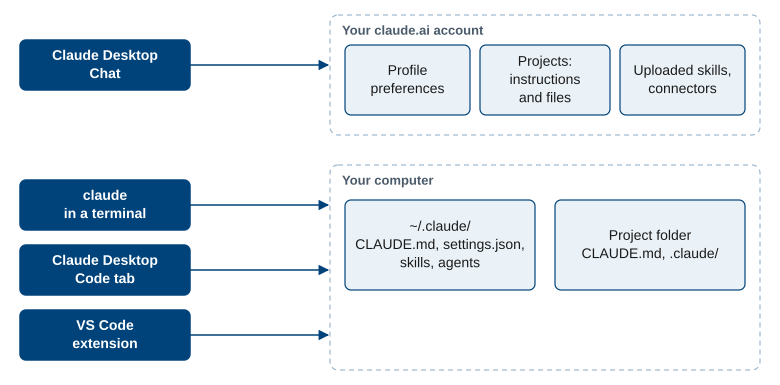
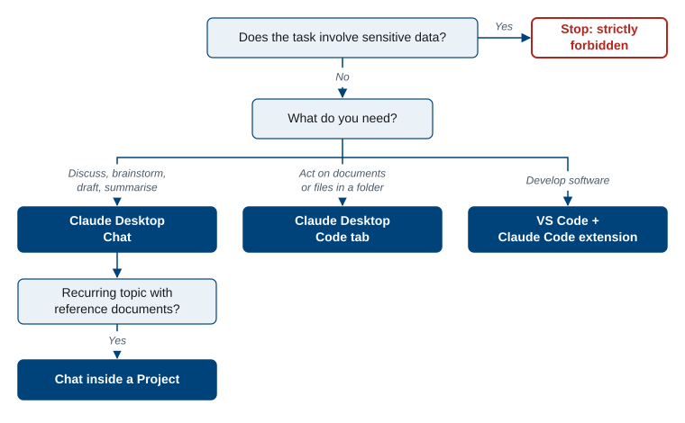

# Using Claude for yourself

This guideline covers individual use: choosing the right tool, asking well, configuring Claude Desktop and
Claude Code, making them learn, and staying in control of what they produce.

**Sharing sensitive data with Claude is strictly forbidden**: patient data, individual-level genomic data, HR
information, confidential evaluations, etc. Non-sensitive internal data can be used freely;
internal confidential material (unpublished projects, budgets, internal reports) only within the scope of the
institutional contract.

**Use your organisation account, not a personal one.** On organisation accounts (Team, Enterprise) and the API,
Anthropic's commercial terms exclude training models on your conversations and files by default: there is nothing
to set. On personal accounts (Free, Pro, Max), a setting in **Settings > Privacy** allows your conversations to be
used for training: turn it off if you ever use one. Claude Code follows the account you log in with; nothing in
`settings.json` controls training (`DISABLE_TELEMETRY` only stops usage statistics). Feedback you send on purpose
(thumbs up/down, `/feedback`) may be kept separately: never send it on a conversation holding confidential content.

---

## 1. Three tools: Claude Desktop, Claude Code and VS Code

### What they are

**Claude Desktop** is the Claude application for your computer (the same as claude.ai in a browser, with extra
integration). You **talk** with Claude: ask, draft, analyse documents you drop in. Conversations can be grouped
in **Projects**, which keep instructions and reference files for a topic you come back to.

**Claude Code** is an agent that **works inside a folder** on your computer: it reads the files, edits them,
runs commands with your own tools (git, conda, Nextflow, Docker…) and checks the result. It exists in three
forms that behave the same way and share the same configuration (`~/.claude/`):

- the `claude` command in a terminal;
- the extension for VS Code or JetBrains;
- the **Code** tab of Claude Desktop.

**VS Code with the Claude Code extension** is Claude Code inside a code editor. Claude works on the same folder
as you, and you see each proposed change as a side-by-side diff that you accept or reject. For software
development, it is the most comfortable way to work with Claude: in a terminal or in Desktop, files change
without you really seeing them, while in VS Code you review every edit where you write code.

### How they fit together

Claude Desktop has two modes, switched with the two icons at the **top left of the window**, next to the
navigation arrows (the highlighted icon is the active mode):

- the speech bubble: **Chat**, the conversation;
- `</>`: **Code**, which is Claude Code inside Desktop.

Desktop can also call Claude Code for you: in a Chat Project, Claude may ask access to a folder on your computer,
or start a Claude Code session there (Remote Control), always with your approval. It is convenient when a
discussion leads to work on files, but it is less direct and less controlled than opening Claude Code yourself.

What each tool reads:



### When to prefer one or the other

The question is not "which application" but **"a conversation, or work inside a folder?"**

| | **Claude Desktop (Chat)** | **Claude Code** |
|---|---|---|
| Starting point | A question, or documents you drop in | A folder: a git repository, a project directory |
| What Claude does | Answers, drafts, analyses what you give it. It can run code in a sandbox on Anthropic's servers (charts, Excel files), not on your disk | Reads the whole folder, edits files, runs your tools, runs tests |
| Configuration | Profile preferences, Project instructions, account skills, connectors (section 3) | `CLAUDE.md`, `settings.json`, skills and agents in `~/.claude/` (section 4) |
| Safety net | You copy or download the output yourself | `deny` and `ask` permissions enforced by the tool |

Decision tree:



| Task | Tool |
|---|---|
| Prepare a meeting, draft a delicate email | Desktop |
| Review a grant proposal or an evaluation report | Desktop (Project if recurrent) |
| Summarise three PDF papers, build a slide deck | Desktop |
| Write or debug a Nextflow pipeline | VS Code |
| Understand an unfamiliar repository, add tests, review before a merge request | VS Code |
| Produce a report from result files in a directory | Desktop, Code tab |
| Rework a thesis or a paper written in Markdown or LaTeX | Desktop, Code tab, or VS Code |

Claude Code is not only for code: it suits any work on a set of files.

### How to launch them

**Claude Desktop**: open it from your applications menu. Choose the speech bubble for Chat, `</>` for Code
(then pick the folder to work in).

**Claude Code** in a terminal:

```bash
# Install (once), then update
curl -fsSL https://claude.ai/install.sh | bash
claude update

# Start in the folder you want Claude to work on (never from ~ or /)
cd ~/Gitlab/my-project
claude

# Useful variants
claude -c                          # continue the last session in this folder
claude -r                          # pick an earlier session to resume
claude --add-dir ~/claude/projects # give access to one more folder
claude -p "summarise the README"   # one-shot answer, no interactive session
```

**VS Code**: install the **Claude Code** extension (publisher Anthropic) from the Extensions view
(`Ctrl+Shift+X`); it needs VS Code 1.94 or later and your Claude account, no API key. Open your project folder,
then click the Claude icon (spark) in the editor toolbar or the activity bar, or press `Ctrl+Esc`. The extension
bundles its own Claude Code: to also run `claude` in VS Code's terminal, install the CLI as above.

Inside a session: `/help` lists commands, `/doctor` checks the installation and configuration, `/<skill-name>`
calls a skill, `/add-dir <path>` adds a folder, `/clear` starts a fresh context.

**One session = one task.** For a different topic, start a new conversation or session: the context stays clean
and relevant.

---

## 2. Ask well (all tools)

Claude does not know what you have not told it. A good request contains four things:

1. **Context**: who you are in this situation, who the output is for, what already exists.
2. **Goal**: what you want to achieve, not only the step ("I need to convince a reviewer that…").
3. **Expected format**: length, structure, language, tone, file type.
4. **Examples or references**: a previous document you liked, a template, a style to follow.

Example:

> Weak: "Summarise this paper."
>
> Better: "I am reviewing this paper for a journal. Summarise in 10 lines the main claim, the methods,
> and the three points a statistical reviewer would challenge. English, bullet points."

Good habits:

- **Iterate**: the first answer is a draft. Say what is wrong and why, rather than starting again.
- **Ask for a recommendation**, not a list of options, when you need to decide.
- **Ask Claude to flag uncertainty** and never to invent references.
- **Give files, not paraphrases**: let Claude read the actual document or code.
- **Correct it explicitly and ask it to remember** ("From now on, do not…"): this is how it becomes *your* assistant.

---

## 3. Claude Desktop

### Configure it

There is no configuration file for Chat: `CLAUDE.md` and `settings.json` **do not apply**. Everything is set in
the app (**Settings**, from your name at the bottom left) and stored in your claude.ai account, so it follows you
on the web and on mobile. Nothing is versioned and nothing is enforced: there is no `deny` or `ask` rule, so the
safety net is your own judgement about what you share.

| Setting | Where in the app | Equivalent in Claude Code |
|---|---|---|
| Personal preferences | Settings > Profile | `~/.claude/CLAUDE.md` |
| Memory, code execution, skills upload | Settings > Capabilities | `memory/` folders, `~/.claude/skills/` |
| Connectors (mail, Drive, calendar…) | Settings > Connectors | MCP servers in `settings.json` |
| Topic-specific instructions and files | Inside each Project | `<project>/CLAUDE.md` |
| Permissions (`deny`, `ask`) | None | `settings.json` |

To keep this configuration versioned, [settings/desktop-preferences.md](../settings/desktop-preferences.md)
holds the text to paste in your profile and a template for Project instructions.

- **Profile preferences**: a short version of your `CLAUDE.md` (language, style, "never invent references",
  "say when you are unsure"). It is sent with every conversation, so keep it short.
- **Projects**: one per recurring topic (e.g. "2027 ANR proposal"), with its own instructions and reference files.
  Use them rather than repeating the context in each conversation.
- **Memory**: if enabled, Claude remembers facts across conversations. Review it from time to time and never let
  sensitive content end up there.
- **Skills**: only the skills of your claude.ai account are available. To use a skill from this repository, zip
  its folder and upload it in Settings > Capabilities.
- **Connectors**: each one widens what Claude can read and exposes you to malicious content ("prompt injection":
  an email or web page hiding instructions). Enable only those you actually use.
- **Organisation settings**: some options (allowed connectors, enabled features) are set by the administrator.
- The only local file, `claude_desktop_config.json` (on Linux usually in `~/.config/Claude/`), declares local MCP
  servers; it does not hold your preferences.

### Good uses

| Activity | Typical uses |
|---|---|
| Scientific writing | Structure a paper, rewrite a section, check consistency between text and figures |
| Evaluation and reviewing | Structure a report, check criteria coverage (no named confidential content without approval) |
| Organisation | Minutes, meeting preparation, recurring emails, scheduled weekly digests |
| Literature watch | Web search and structured synthesis with sources |
| Documents | Word, PowerPoint, Excel and PDF files, generated or analysed |

---

## 4. Claude Code

### Configure it

This repository provides ready-to-use templates; see [settings/README.md](../settings/README.md) for details.

- `settings/CLAUDE.md` → copy to `~/.claude/CLAUDE.md` and fill in the `XXX` placeholders: profile, language,
  working style, actions that need approval, confidentiality, memory.
- `settings/settings.example.json` → merge into `~/.claude/settings.json`: credentials denied, outward-facing
  actions (`git push`, `rm`, `scp`, `sbatch`…) confirmed, telemetry off, reads limited to authorised folders.

The key rule: **`CLAUDE.md` is advice the model follows; `settings.json` is a rule the tool enforces.**
Anything that must never happen belongs in `settings.json`.

Per-project files complete the global ones:

| File | Scope | Committed? |
|---|---|---|
| `~/.claude/CLAUDE.md` | All your sessions | No |
| `<project>/CLAUDE.md` | This project, for everyone | Yes (no personal content) |
| `<project>/CLAUDE.local.md` | This project, you only | No (already in `.gitignore`) |

Validate JSON after each edit (`python -m json.tool ~/.claude/settings.json`) and run `/doctor`:
an invalid file is ignored.

### Memory

Claude Code keeps plain-text memory files per working folder (`~/.claude/projects/<folder>/memory/`).

- Memory is evolving notes; `CLAUDE.md` is the stable rule. Once a month, promote memories that have become
  rules into `CLAUDE.md`, and clean up the rest.
- Read the files, edit or delete them freely. Never let sensitive content end up there.

### Skills and sub-agents

A **skill** is a reusable procedure Claude loads when a task matches it. Create one as soon as you notice you
are explaining the same method twice.

- Location: `~/.claude/skills/<name>/SKILL.md` (personal), or `<project>/.claude/skills/` (shared through git).
- The `description` field decides when the skill triggers: write it as "Use when…".
- Call it with `/<name>`, or just describe the task. The easiest start: "Create a skill for [task]".
- Examples in this repository: [`review-manuscript`](../skills/review-manuscript/SKILL.md),
  [`review-issues`](../skills/review-issues/SKILL.md).

A **sub-agent** is a specialised assistant with its own instructions and tools, stored in
`~/.claude/agents/<name>.md`. Restricting its tools to read-only (`tools: Read, Grep, Glob`) is also a safety
measure: a "critical reviewer" agent cannot modify anything.

### Good practices

- Start Claude Code from the project folder, never from `~` or `/`.
- For a large task, **ask for a plan first**, validate it, then let Claude execute.
- Keep the confirmation mode until your configuration is proven; use automatic modes only in folders without
  sensitive data.
- **Review every diff** before committing; run the tests yourself.
- Do not use Claude Code on the web (claude.ai/code, in the cloud) for confidential manuscripts or data.

---

## 5. VS Code

### Configure it

The extension runs Claude Code, so **your Claude Code configuration applies**: the documentation states that
`~/.claude/settings.json` (permissions, environment variables, MCP servers), the conversation history and plugins
are shared between the extension and the CLI. The same `CLAUDE.md` files and skills are read in the folder you open;
the extension's menus let you edit the `CLAUDE.md` files and list the skills. There is nothing extra to configure.

Two differences with the terminal: only a subset of slash commands and skills is offered (type `/` to see them),
and some CLI features (the `!` shortcut, tab completion) are missing. For those, run `claude` in VS Code's
integrated terminal.

### See and control every change

The permission mode is shown at the bottom of the prompt box:

| Mode | Behaviour | When |
|---|---|---|
| **Manual** | Claude asks before each file edit and most commands, and shows a side-by-side diff | Default; keep it while you learn |
| **Plan** | Claude describes what it will do and waits for your approval; you can comment the plan | Large or risky changes |
| **Edit automatically** | Claude edits without asking | Only on a clean git branch, to review afterwards |

In the diff, accept or reject each change, or edit the proposed code before accepting it. Never use the
"bypass permissions" mode outside an isolated sandbox.

### Good practices

- Open the repository folder itself, not your home directory.
- Work on a dedicated git branch; use VS Code's Source Control panel to review the whole change set before committing.
- Ask for a plan first on anything larger than a small fix, then let Claude execute it step by step.
- Run the tests yourself before committing.
- Continue a VS Code conversation in the terminal with `claude --resume` if needed: the history is shared.

---

## 6. Check and stay in control (all tools)

- **Claude can be confidently wrong.** Check figures, references, tool versions and scientific conclusions.
  Open every cited source before reusing it.
- **You remain the author and are responsible** for everything you sign, commit or send.
- **Nothing leaves without you**: sending, publishing, pushing and job submission stay under your approval.
- **Declare AI use.** For code, add an `## AI Disclosure` section to the README using
  [templates/AI_DISCLOSURE.md](../templates/AI_DISCLOSURE.md); choose the level yourself. For papers and grant
  proposals, follow the journal's or funder's policy.
- **Watch for the AI style**: generic phrasing and hype weaken a scientific text. The `review-manuscript` skill
  includes a list of tells ([ai-style-tells.md](../skills/review-manuscript/references/ai-style-tells.md)).

---

## Getting started

### Prepare your environment

- [ ] Claude Code - merge `settings.example.json` into `~/.claude/settings.json`, add your sensitive paths, validate the JSON.
- [ ] Claude Code - fill in `~/.claude/CLAUDE.md` from the template, add a `CLAUDE.md` to one or two active repositories.
- [ ] Claude Desktop - review enabled connectors; disable unused ones.
- [ ] Claude Desktop - paste your profile preferences from `settings/desktop-preferences.md`, create a Project for your main recurring topic.

### Create your own skills

- [ ] List your five most repetitive tasks.
- [ ] Create two or three skills for the most frequent ones, use them, fix them after each disappointing run.
- [ ] To use a skill in Claude Desktop, zip its folder and upload it in Settings > Capabilities.

### Make Claude learn

- [ ] Correct Claude explicitly and ask it to remember.
- [ ] Monthly: review memory, promote stable rules to `CLAUDE.md`.

### Maintain

- [ ] Quarterly: review permissions and connectors.

---

## Summary: which tool for which need

| Need | Tool |
|---|---|
| Chat, brainstorming, drafting, summarising documents you provide | Claude Desktop, Chat mode |
| Acting on documents and files in a folder | Claude Desktop, Code mode (`</>`) |
| Software development | VS Code with the Claude Code extension (or Claude Code in a terminal, less comfortable) |
