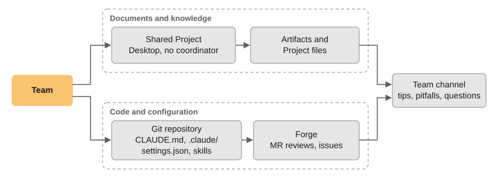
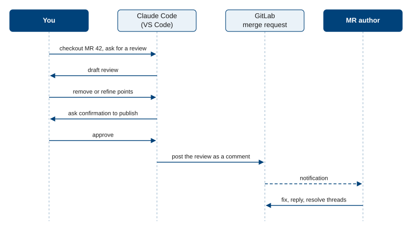

# Using Claude as a team

This guideline covers team use. It follows the same structure as [individual-use.md](individual-use.md),
which everyone should read first: common rules, then Claude Desktop, then Claude Code.

The team works with Claude in two complementary ways:

- **Claude Desktop, through shared Projects**, for documents and knowledge: grant proposals, courses, procedures,
  collective reviews. Nothing to install, but nothing is versioned.
- **Claude Code, through git repositories**, for code and configuration: project context, shared permissions,
  our library of skills. Everything is versioned and reviewed through merge requests.

**The individual rules apply to everyone, without exception**: sharing sensitive data with Claude is strictly
forbidden, and only organisation accounts are used for work.

---

## 1. Shared rules (both tools)

- **One person is responsible for every output.** Whoever commits, sends or publishes something produced with
  Claude owns it, as if they had written it alone.
- **Human review is mandatory** before anything Claude produced is merged, sent outside the team or published.
- **Be transparent.** Say when a document, a review or a piece of code was largely produced with Claude. For code,
  use an `## AI Disclosure` section ([templates/AI_DISCLOSURE.md](../templates/AI_DISCLOSURE.md)).
- **Respect other people's confidentiality.** Never give Claude a colleague's unpublished work, or a document
  received in confidence, without the author's agreement.
- **No secrets in shared content.** No token, password, server address or personal data in a shared Project,
  a committed `CLAUDE.md`, a skill or a settings file.
- **Messages under your name stay yours.** When Claude drafts a comment, an issue or an email that goes out under
  your name, re-read it and mention that it was drafted with Claude when it matters.

---

## 2. Claude Desktop

### Shared Projects

A Project holds instructions and reference files. Shared with colleagues of the organisation, it gives everyone
the same context: each member has their own conversations, but nobody needs to re-explain the topic.

How to create one:

1. Your organisation's admin must have enabled project sharing in the organisation settings.
2. Click **New project**, and **turn off "Project coordinator" (beta)**: a Project with the coordinator enabled
   stays private and cannot be shared.
3. Choose who can see it (the whole organisation or invited members), then add members with **Can view**
   (use the Project) or **Can edit** (change its instructions, files and members).

A personal Project with the coordinator cannot be turned into a shared one: create a new shared Project and copy
into it the instructions, reference files and artifacts the team needs.

Good candidates:

| Shared Project | Reference files | Members |
|---|---|---|
| A grant proposal written together | Call text, previous submissions, budget template | The writing team |
| Team knowledge base | Procedures, conventions, FAQ, onboarding notes | The whole team |
| A course or a training session | Slides, exercises, syllabus | The teaching team |
| A collective review or a jury | Evaluation grid, call rules (no confidential submissions without approval) | The reviewers |

Rules:

- **One owner per shared Project**: the person who creates it writes its instructions, chooses its members and
  removes it when it is no longer needed.
- **Everything in a shared Project is visible to all its members**: files, instructions, and anything Claude
  retrieved and wrote there. Only add what every member is entitled to see.
- **Keep the reference files current**: remove outdated versions, or Claude will mix them with new ones.
- **Instructions follow the template** in [settings/desktop-preferences.md](../settings/desktop-preferences.md):
  goal, reference files, expected outputs, what is out of scope.

### Sharing conversations and artifacts

Conversations and artifacts (documents, pages, diagrams Claude produced) are private by default. Share them on
purpose, and check their content first: a shared conversation shows every file and message in it.

### Organisation settings

The organisation's administrator decides which connectors and features are available to everyone. Connectors stay
personal: a shared Project does not give colleagues access to your mailbox or drive.

### Using the team's skills

Skills from this repository can be used in Claude Desktop: zip the skill folder and upload it in
Settings > Capabilities. Each member does it on their own account.

---

## 3. Claude Code

In Claude Code, Projects always use the coordinator (beta) and stay personal: **the shared space is the git
repository**. Context, permissions and skills are versioned there, and results (reviews, issue triage) are
published in the forge, where every collaborator sees them.

### Shared context in repositories

Commit a `CLAUDE.md` at the root of each active repository: everyone who runs Claude Code there gets the same
context. Put in it:

- what the project does, in three lines, and where the important code lives;
- how to install, build, test and run it (exact commands);
- coding conventions: language, style, workflow framework, container policy, test framework;
- project rules: "never modify `data/raw/`", "every new process needs a test", "update the CHANGELOG";
- links to the key documentation rather than copies of it.

Keep it short, factual and free of personal details. Update it through merge requests like any other file.

| File | Committed? | Use |
|---|---|---|
| `<project>/CLAUDE.md` | Yes | Context and rules for everyone |
| `<project>/CLAUDE.local.md` | No (in `.gitignore`) | Your personal notes for this project |
| `<project>/.claude/settings.json` | Yes | Shared permissions |
| `<project>/.claude/settings.local.json` | No | Your personal overrides |

If a repository already has an `AGENTS.md` (used by other AI tools), write `@AGENTS.md` in `CLAUDE.md` to import it.

### Shared permissions

A committed `.claude/settings.json` lets the team agree on what Claude may do in a project:

- `allow` the project's read-only and test commands (`nextflow config *`, `pytest *`) to avoid needless prompts;
- `deny` reads of folders that must never be read (`data/patients/**`, credentials);
- `ask` before anything that leaves the machine or is hard to undo (`git push *`, `sbatch *`, `rm *`).

Personal settings still apply on top. `deny` always wins, so a project cannot loosen what you have denied for yourself.

### A common library of skills and agents

This repository is the team's library: `skills/` and `agents/` hold what we found useful enough to share.

To add a skill:

1. Write it and use it yourself first, on real tasks.
2. Make it generic: no personal details, no project paths, `XXX` placeholders where needed.
3. Write a `description` that starts with "Use when…": it decides when Claude loads the skill.
4. Open a merge request. A colleague tries it on one of their own cases before it is merged.
5. Name an owner: the person who answers questions and keeps it up to date.

Conventions: one folder per skill in English kebab-case (`review-manuscript`, `review-issues`); supporting files in
a `references/` subfolder; a skill never publishes, pushes or closes anything without asking first.

To use it, copy the skills you want into `~/.claude/skills/`, or into `<project>/.claude/skills/` when a skill only
makes sense for one repository. Pull this repository regularly and copy again to get updates.

### Collaborative code

Claude Code is a contributor like any other: its work goes through the same merge requests and the same review.

- **Before a merge request**, ask Claude to review your own diff ("review this branch against main").
- **Reviewing a colleague's merge request** with Claude is fine as a first pass. Your review and your approval
  remain yours.
Sharing a merge request review:

- **Attribution**: Claude Code adds a `Co-Authored-By: Claude` line to commits it writes. Keep it.
- **Issues**: the [`review-issues`](../skills/review-issues/SKILL.md) skill helps triage a project's issues.
  It never closes or edits an issue without confirmation, and comments go out under your name.
- **Pushing, merging and deploying stay human decisions.** The `ask` rules in `settings.json` enforce it for
  `git push`; do not bypass them.

---

## 4. Sharing what we learn (both tools)

The team's discussion channel (Teams, Slack or similar) is where we pool our experience. Post there:

- prompts and workflows that worked well, with the context they worked in;
- failures and pitfalls: wrong answers, invented references, risky actions Claude attempted;
- new skills and shared Projects, and requests for ones someone may already have;
- questions about what is allowed.

To welcome a new member:

- [ ] Point them to [individual-use.md](individual-use.md) and this document.
- [ ] Make sure they use their organisation account.
- [ ] Add them to the relevant shared Projects.
- [ ] Help them set up `~/.claude/` from this repository (settings, `CLAUDE.md`, a first skill).
- [ ] Pair with them on one real task, in Claude Desktop and in Claude Code.

---

## Getting started

### Claude Desktop

- [ ] Create a shared Project for the team knowledge base, with its owner and instructions.
- [ ] Open a shared Project for each ongoing collective piece of writing.

### Claude Code

- [ ] Add a `CLAUDE.md` to each active repository, reviewed by its main contributors.
- [ ] Add a `.claude/settings.json` to repositories that need shared permissions.
- [ ] Check that `CLAUDE.local.md` and `.claude/settings.local.json` are in `.gitignore`.

### Build the library

- [ ] Each member proposes one skill they already use, through a merge request.
- [ ] Each skill has an owner and has been tried by a second person.

### Share experience

- [ ] Post your first useful prompt or pitfall in the team channel.
- [ ] Onboard each newcomer with the checklist in section 4.

### Maintain

- [ ] Quarterly: review the guidelines, the library, the shared Projects and the shared permissions together.
